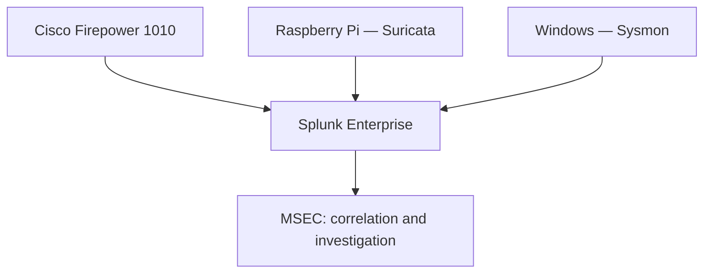
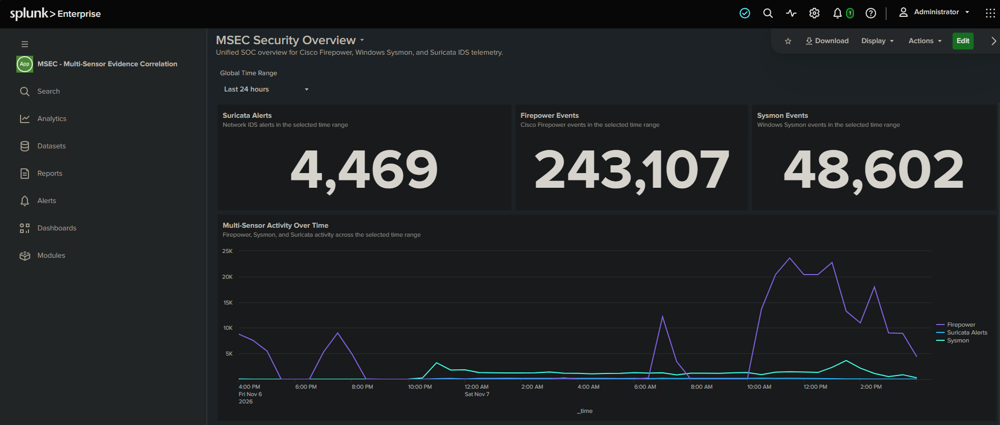
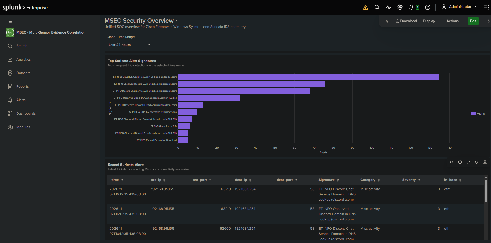
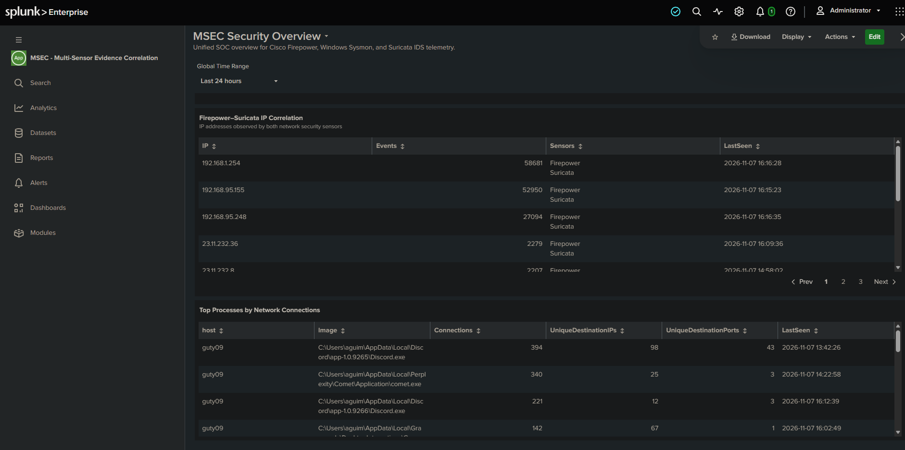
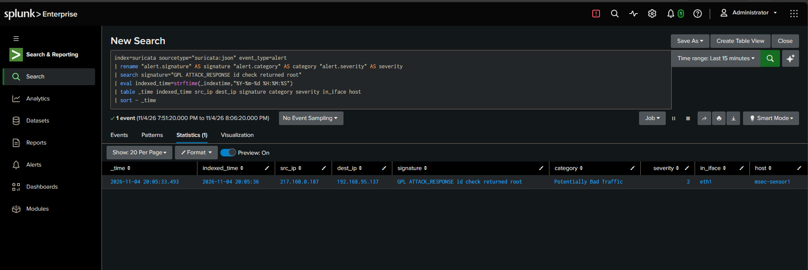
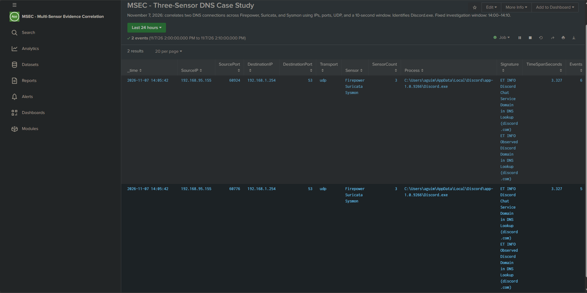
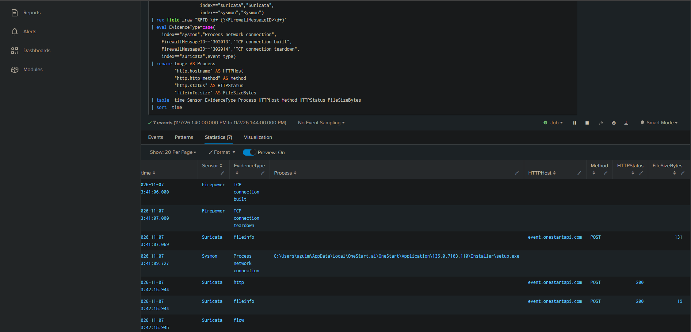

# MSEC — Multi-Sensor Evidence Correlation

A custom Splunk application that connects firewall, network IDS, and Windows endpoint evidence for detection engineering and incident investigation.

**Status:** Active development. App configuration, dashboard, field extractions, and detection searches are published under [`app/msec`](app/msec). Correlation has been demonstrated in the physical lab. Installation on a separate Splunk instance has not yet been validated.

## Project Purpose

MSEC brings related observations together so an analyst can investigate:

- Which endpoint and process generated a connection?
- What did the firewall record?
- Did Suricata identify related network activity?
- How closely do the observations align?
- What evidence is available, and what remains unknown?

MSEC builds on my **Enterprise Home SOC** foundation as a separate project focused on evidence correlation and investigation.

## Architecture



The lab uses physical hardware:

| Component | Role |
|---|---|
| Cisco Firepower 1010 | Firewall connection telemetry |
| Cisco Catalyst C1200 | Switch port mirroring |
| Raspberry Pi 5 | Suricata sensor with a dedicated monitoring interface |
| Dell Windows endpoint | Sysmon process, network, and DNS telemetry |
| Splunk server | Indexing, searches, dashboards, and scheduled detections |

## Repository Contents

| Path | Purpose |
|---|---|
| [`app/msec/default/app.conf`](app/msec/default/app.conf) | App identity and visibility |
| [`app/msec/default/props.conf`](app/msec/default/props.conf) | Sysmon and Firepower field extractions |
| [`app/msec/default/transforms.conf`](app/msec/default/transforms.conf) | Firepower key-value transformation |
| [`app/msec/default/savedsearches.conf`](app/msec/default/savedsearches.conf) | Two detection rules and a historical DNS case-study search |
| [`app/msec/default/data/ui/views/msec_security_overview.xml`](app/msec/default/data/ui/views/msec_security_overview.xml) | Dashboard Studio definition |
| [`app/msec/metadata/default.meta`](app/msec/metadata/default.meta) | App-scoped permissions |

The temporary synthetic test alert is excluded from the published app.

## Dashboard

**MSEC Security Overview** includes:

- Firepower, Sysmon, and Suricata event counts.
- Multi-sensor activity over time.
- Top Suricata signatures and recent alerts.
- Firepower–Suricata IP overlap.
- Top endpoint processes by network connections.

The IP overlap panel identifies addresses observed by both network sensors. It does not establish that their events describe the same connection.

Connection-level correlation is demonstrated separately through searches matching IPs, ports, protocol, and time.

## Verified Three-Sensor Correlation

Two DNS connections were correlated across all three sensors within a ten-second window.

| Sensor | Evidence |
|---|---|
| Firepower | UDP connection creation and teardown |
| Suricata | Discord-related DNS signatures |
| Sysmon | Network events identifying `Discord.exe` |

The correlated records spanned **3.327 seconds**.

This demonstrates evidence correlation. The informational signatures do not, by themselves, establish malicious activity.

The three-sensor search, findings, and screenshot are published in the [Discord DNS case study](case-studies/three-sensor-dns-correlation.md).

## Detection Content

| Rule | Purpose | Validation |
|---|---|---|
| OneStart Execution After Removal | Identify process creation from the OneStart.ai directory for possible recurrence | Matched 11 historical executions in the selected test window; recent search returned zero matches; scheduled execution verified |
| PowerShell Connection Corroborated by Firepower | Associate PowerShell TCP activity with matching firewall connection records within ten seconds | Historical match verified with a 2.73-second span; live controlled connection to 1.1.1.1:443 verified in scheduled alert results |

Both rules include a five-minute schedule, ten-minute search window, and one-hour throttling by endpoint.

**Scheduling is off by default in the published configuration.** Enable rules only after reviewing their searches and validating telemetry in the target environment.

A separate synthetic test successfully validated recording in Triggered Alerts. This tested alert handling, not the detection logic.

### Interpretation

- The OneStart rule matches a directory path; it does not identify renamed or relocated copies.
- The PowerShell rule provides investigation context. A matching connection alone does not establish malicious activity or successful data transfer.
- An empty recent search is a baseline observation, not a comprehensive false-positive test.

## Telemetry Requirements

The published searches expect:

| Index | Sourcetype / content |
|---|---|
| `firewall` | `cisco:ftd` |
| `suricata` | `suricata:json`, with JSON fields extracted |
| `sysmon` | `XmlWinEventLog:Microsoft-Windows-Sysmon/Operational` |

Relevant Sysmon events include process creation, network connections, and DNS queries.

The app does not configure Sysmon, Suricata, forwarding, receivers, indexes, or JSON parsing. These must already be configured. Users with different index names or sourcetypes must adapt the searches and extraction stanzas.

The supplied Sysmon extractions expect XML fields using single-quoted `Data Name` attributes, as observed in the lab.

## Initial Installation

These instructions target a standalone Splunk Enterprise instance. The lab uses Splunk Enterprise 10.4.1.

1. Clone or download this repository.
2. Review the configuration under `app/msec`.
3. For a new installation, copy the `msec` folder into the target Splunk installation's `etc/apps` directory.
4. Restart Splunk to load the app.
5. Open **MSEC** and verify the expected indexes and extracted fields.
6. Review and test saved searches before enabling their schedules.

On Windows, the resulting app path is typically:

```text
C:\Program Files\Splunk\etc\apps\msec
```

If MSEC is already installed, back up and compare its configuration before applying changes. Existing `local` configuration can override the supplied `default` configuration.

The historical Discord case study contains lab-specific IPs, ports, and an absolute time window. It requires the original indexed events to reproduce its results; it is not a live detection.

## OneStart Investigation

Sysmon exposed OneStart execution on the Windows endpoint. Investigation identified application and updater activity, network connections, and scheduled tasks.

The application was uninstalled, its processes stopped, and related scheduled tasks removed. A recurrence rule was then configured.

This case demonstrates progression from telemetry review to investigation, remediation, and follow-up monitoring.

## Remaining Work

- Document a reusable investigation workflow based on the completed case studies.
- Validate the exported app in an isolated installation.
- Package a versioned release with validation results and known limitations.

Broader attack coverage and performance testing are future improvements.
## Limitations

Correlation depends on telemetry coverage, timestamp alignment, and matching connection details. Missing matches do not prove that activity did not occur.

The PowerShell correlation currently parses IPv4 Firepower TCP connection records using the lab's `inside` and `outside` interface names.

The searches use `transaction` and were validated at home-lab scale. Larger deployments require performance testing and tuning.

## License

MIT — see [LICENSE](LICENSE).

## Screenshots

### Security Overview

Event counts and activity across Firepower, Suricata, and Sysmon.



### Suricata Alerts

Top signatures and recent IDS alerts.



### Process and Network Visibility

Firepower-Suricata IP overlap and Sysmon process network activity.



### IDS Test Validation

A controlled Suricata test alert ingested into Splunk.



## Three-Sensor Investigation Case Study

Two DNS connections matched across Firepower, Suricata, and Sysmon, identifying Discord.exe within a 3.327-second timestamp span.

[Read the investigation, evidence, and reproducible SPL](case-studies/three-sensor-dns-correlation.md)



## OneStart Three-Sensor Investigation

Sysmon attributed a TCP connection to OneStart's installer. Firepower corroborated the connection, and Suricata recorded an HTTP POST and a 200 response.

[Read the evidence timeline, investigation, and limitations](case-studies/onestart-three-sensor-investigation.md)


