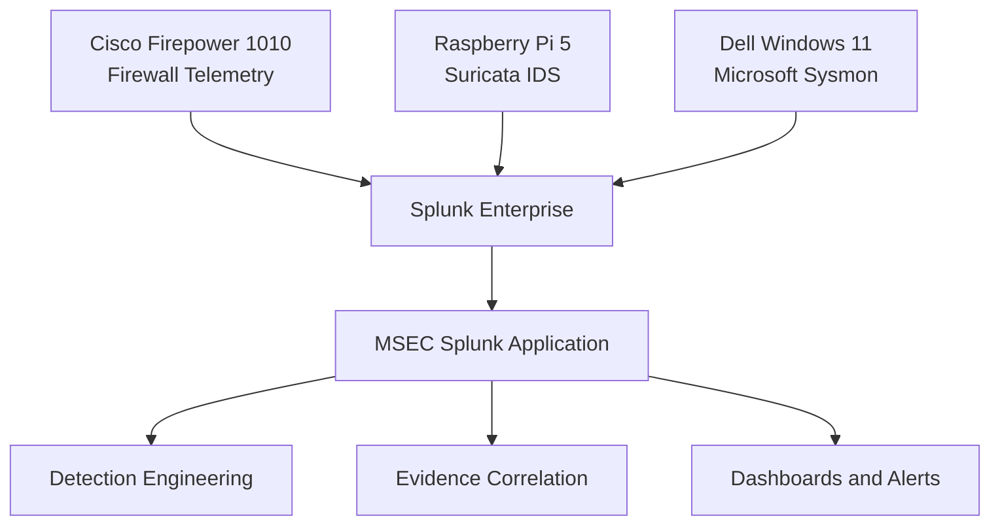
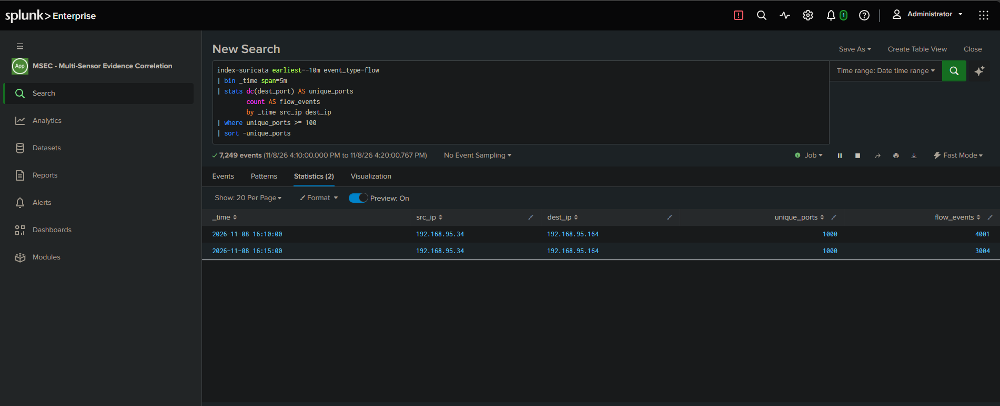

# MSEC — Multi-Sensor Evidence Correlation

**Custom Splunk Application | Detection Engineering | Security Operations | Incident Investigation**

MSEC is a custom Splunk Enterprise application developed to correlate firewall, network intrusion detection, and Windows endpoint telemetry within a physical enterprise-style Security Operations Center (SOC).

The project combines Cisco Firepower 1010, Suricata, Microsoft Sysmon, and Splunk Enterprise to investigate security activity, develop detection rules, validate alerts, and reconstruct evidence across security sensors.

**Project Status:** Active development. Core application configuration, dashboards, field extractions, detection searches, and controlled investigation case studies are available. Independent installation and production-scale performance have not yet been validated.

MSEC builds on the separate [Enterprise Home SOC](https://github.com/guty09/Enterprise-Home-SOC) foundation project.

## Project Objectives

- Correlate endpoint, firewall, and network IDS telemetry.
- Develop and validate scheduled security detections.
- Map suspicious behaviors to MITRE ATT&CK.
- Reconstruct security events using multiple evidence sources.
- Identify gaps in sensor visibility.
- Build repeatable SOC investigation workflows.
- Document controlled attack simulations and investigation findings.

## Architecture



### Physical Lab Components

| Component | Function |
|---|---|
| Cisco Firepower 1010 | Next-generation firewall and network security telemetry |
| Cisco Catalyst C1200 | Managed switching and SPAN traffic mirroring |
| Raspberry Pi 5 | Suricata network monitoring sensor |
| Dell Windows 11 | Monitored endpoint with Sysmon |
| Kali Linux | Bare-metal attack simulation workstation |
| Splunk Enterprise | Centralized SIEM and detection platform |
| MSEC | Custom correlation, investigation, and alerting application |

The environment uses physical hardware rather than virtualized attack and monitoring systems.

## MSEC Security Overview

The MSEC dashboard provides:

- Firewall, Sysmon, and Suricata event counts.
- Multi-sensor activity over time.
- Suricata signatures and recent alerts.
- Firepower–Suricata IP overlap.
- Endpoint process and network activity.
- Centralized investigation visibility.

IP overlap alone does not establish that different sensors observed the same connection. Connection-level correlation requires matching relevant fields and timestamps.


### Network IDS Visibility


### Endpoint and Network Activity


## Verified Three-Sensor Correlation

MSEC demonstrated correlation of DNS-related activity across Cisco Firepower, Suricata, and Microsoft Sysmon.

| Sensor | Evidence |
|---|---|
| Cisco Firepower | UDP connection creation and teardown |
| Suricata | Discord-related DNS signatures |
| Microsoft Sysmon | Network events identifying `Discord.exe` |

The correlated observations spanned **3.327 seconds**.

This demonstrates multi-sensor evidence correlation, not necessarily malicious activity. Informational IDS signatures are not proof of compromise.

[Read the Three-Sensor DNS Correlation Case Study](case-studies/three-sensor-dns-correlation.md)


## OneStart Three-Sensor Investigation

A controlled investigation examined OneStart-related activity on the monitored Windows endpoint.

Sysmon identified process activity associated with OneStart. Cisco Firepower corroborated network connections, while Suricata recorded related HTTP traffic, including an HTTP POST and a 200 response.

The investigation documented endpoint attribution, network evidence, timeline reconstruction, and the limitations of interpreting the observed activity.

[Read the OneStart Three-Sensor Investigation](case-studies/onestart-three-sensor-investigation.md)


## Detection Engineering

MSEC includes detection engineering work covering endpoint execution, firewall corroboration, and network reconnaissance.

| Detection | Telemetry | Validation |
|---|---|---|
| OneStart Execution After Removal | Sysmon | Historical execution matches and scheduled execution verified |
| PowerShell Connection Corroborated by Firepower | Sysmon + Firepower | Historical correlation and controlled live connection validated |
| Network Port Scan Detection — T1046 | Suricata | Automated scheduled alert successfully triggered |

The original published detection rules use five-minute scheduling, ten-minute search windows, and endpoint-based throttling. Scheduling is disabled by default in the published configuration.

The port-scan detection was separately validated in the running MSEC instance. Its exported configuration must be verified before it is described as packaged with the application.

## Detection 001 — Internal Network Service Discovery

**MITRE ATT&CK:** T1046 — Network Service Discovery  
**Category:** Discovery  
**Telemetry:** Suricata  
**Validation Date:** November 8, 2026  
**Status:** Validated

### Attack Scenario

A bare-metal Kali Linux workstation performed a controlled TCP SYN scan against a Windows 11 endpoint on the same internal network.

```bash
sudo nmap -sS -Pn -n -p 1-1000 192.168.95.164
```

The Cisco Catalyst switch mirrored traffic to the Raspberry Pi running Suricata.

Suricata generated network flow telemetry, which Splunk ingested into the `suricata` index.

### Detection SPL

```spl
index=suricata earliest=-10m event_type=flow
| bin _time span=5m
| stats dc(dest_port) AS unique_ports
        count AS flow_events
        by _time src_ip dest_ip
| where unique_ports >= 100
| sort -unique_ports
```

The detection identifies source-to-destination pairs contacting at least 100 distinct destination ports within a five-minute aggregation bucket.

Using `dc(dest_port)` reduces the effect of duplicate mirrored traffic on the unique-port count.

### Validated Results

| Metric | Observed Result |
|---|---|
| Source IP | `192.168.95.34` — Kali Linux |
| Destination IP | `192.168.95.164` — Dell Windows 11 |
| First aggregation window | 1,000 unique ports; 4,001 flow events |
| Second aggregation window | 1,000 unique ports; 3,004 flow events |
| Alert schedule | Every five minutes |
| Search window | Last ten minutes |
| Alert threshold | 100 unique destination ports |
| Automated trigger | November 8, 2026, 4:20 PM PST |
| Validation | PASS |

The two results represent separate five-minute aggregation buckets, not necessarily separate attacks.

### Detection Evidence



[Read the Complete T1046 Detection Case Study](case-studies/internal-network-port-scan-t1046.md)

### Sensor Visibility

This test validates a **single-sensor detection**, not three-sensor correlation.

Suricata observed the mirrored traffic and supplied the detection evidence.

Cisco Firepower did not observe the scan because the attacker and target were on the same internal subnet and their traffic did not traverse the firewall.

Sysmon visibility was not confirmed.

A future controlled test will place the attacker on a separate network and evaluate telemetry visibility across the firewall, network sensor, and endpoint.

## Telemetry Requirements

| Index | Expected Telemetry |
|---|---|
| `firewall` | Cisco Firepower, `cisco:ftd` |
| `suricata` | Suricata JSON, `suricata:json` |
| `sysmon` | Windows Sysmon operational events |

Relevant Sysmon events include process creation, network connections, and DNS queries.

The application does not automatically configure Sysmon, Suricata, log forwarding, Splunk indexes, or event receivers.

Users must configure these components independently and adapt searches to their environments.

## Repository Structure

```text
MSEC/
├── app/
│   └── msec/
│       ├── default/
│       │   ├── app.conf
│       │   ├── props.conf
│       │   ├── savedsearches.conf
│       │   ├── transforms.conf
│       │   └── data/ui/views/
│       │       └── msec_security_overview.xml
│       └── metadata/
│           └── default.meta
├── case-studies/
│   ├── three-sensor-dns-correlation.md
│   ├── onestart-three-sensor-investigation.md
│   └── internal-network-port-scan-t1046.md
├── evidence/
│   └── screenshots/
├── README.md
└── LICENSE
```

## Installation

These instructions target a standalone Splunk Enterprise instance. The physical lab uses Splunk Enterprise 10.4.1.

1. Clone or download this repository.
2. Review the application configuration in `app/msec`.
3. Copy the `msec` directory into the target Splunk installation's `etc/apps` directory.
4. Restart Splunk.
5. Open the MSEC application.
6. Verify indexes, field extractions, and dashboard data.
7. Review and validate saved searches before enabling scheduled detections.

Typical Windows installation path:

```text
C:\Program Files\Splunk\etc\apps\msec
```

Existing `local` configuration can override settings in `default`. Back up and compare existing configurations before updating an installed application.

## Detection Limitations

- Detection accuracy depends on telemetry coverage and timestamp alignment.
- Not every sensor observes every network connection.
- The T1046 detection uses a fixed threshold that requires additional tuning.
- SPAN mirroring can duplicate observed traffic.
- Five-minute aggregation windows can split longer scanning activity.
- Authorized vulnerability scanning may produce matching activity.
- Matching firewall and endpoint records do not establish malicious intent.
- Correlation searches have been validated at home-lab scale, not production scale.
- Installation and performance on an independent Splunk instance remain unverified.

## Future Development

- Validate external-to-internal attack scenarios through Cisco Firepower.
- Expand multi-sensor detection correlation.
- Introduce entity-based risk scoring.
- Develop reusable investigation playbooks.
- Improve detection tuning and false-positive handling.
- Export and verify the latest scheduled detection configuration.
- Validate installation on an isolated Splunk instance.
- Package a versioned MSEC release.

## License

MIT — see [LICENSE](LICENSE).

---

**MSEC demonstrates practical detection engineering, SIEM development, network monitoring, and evidence-based incident investigation using a physical enterprise security lab.**