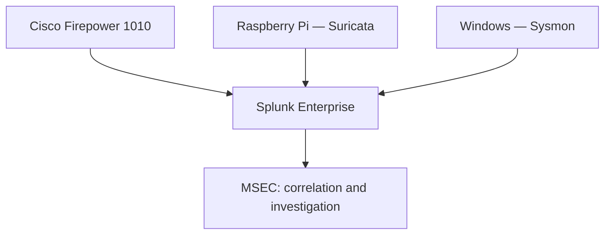

# MSEC — Multi-Sensor Evidence Correlation

A custom Splunk application that connects firewall, network IDS, and Windows endpoint evidence to support detection engineering and incident investigation.

**Status:** Active development. Core telemetry ingestion, the security overview dashboard, and connection correlation are working in the physical lab. App configuration and supporting evidence are being prepared for publication.

## Project Purpose

A network alert tells only part of the story. MSEC brings related observations together so an analyst can investigate:

- Which endpoint and process generated a connection?
- What did the firewall record?
- Did Suricata identify related network activity?
- How closely do the observations align?
- What evidence is available, and what remains unknown?

MSEC is a separate project built on my **Enterprise Home SOC** foundation. It extends the existing telemetry pipeline into correlation and investigation workflows.

## Architecture

The lab uses physical hardware:

| Component | Role |
|---|---|
| Cisco Firepower 1010 | Firewall connection telemetry |
| Cisco Catalyst C1200 | Switch port mirroring |
| Raspberry Pi 5 | Suricata sensor with a dedicated monitoring interface |
| Dell Windows endpoint | Sysmon process, network, and DNS telemetry |
| Splunk server | Indexing, searches, dashboards, and scheduled detections |

## Working Capabilities

- Firepower, Suricata, and Sysmon telemetry ingested into Splunk.
- Search-time field extraction and normalization.
- MSEC Security Overview dashboard.
- Process-level network activity summaries.
- DNS alert correlation between Suricata and Sysmon.
- Three-sensor connection correlation.
- Scheduled detection searches with throttling and triggered-alert records.

## Verified Correlation Example

Two DNS connections were correlated across all three sensors by matching source and destination IPs, ports, and protocol within a ten-second window.

| Sensor | Evidence |
|---|---|
| Firepower | UDP connection creation and teardown |
| Suricata | Discord-related DNS signatures |
| Sysmon | Network events identifying `Discord.exe` |

The correlated records spanned **3.327 seconds**.

This demonstrates evidence correlation. The informational DNS signatures do not, by themselves, establish malicious activity.

## Detection Content

| Rule | Purpose | Validation |
|---|---|---|
| OneStart Execution After Removal | Monitor process creation from the OneStart.ai directory for possible recurrence | Historical execution matched; recent search returned no matches; scheduled execution verified |
| PowerShell Connection Corroborated by Firepower | Associate PowerShell TCP activity with matching firewall connection records | Historical correlation verified; scheduled run returned a match; controlled-test result review pending |

A separate synthetic alert successfully validated the Triggered Alerts action.

## Investigation Case Study

Sysmon exposed OneStart execution on the Windows endpoint. Investigation identified application and updater activity, network connections, and scheduled tasks.

The application was uninstalled, its processes stopped, and related scheduled tasks removed. A recurrence detection was then configured.

This case demonstrates the progression from telemetry review to investigation, remediation, and follow-up monitoring.

## Current Work

- Complete controlled validation of the PowerShell correlation rule.
- Build a reusable investigation workflow.
- Export and review the working Splunk app configuration.
- Publish selected screenshots, searches, and correlation evidence.
- Document installation requirements and detection limitations.

## Limitations

Correlation depends on available telemetry, timestamp alignment, and matching connection details. Missing matches do not prove that activity did not occur.

The current searches were validated at home-lab scale. Broader deployment requires performance testing and environment-specific tuning.

**The installable app package is not yet published in this repository.**

## License

MIT — see [LICENSE](LICENSE).
