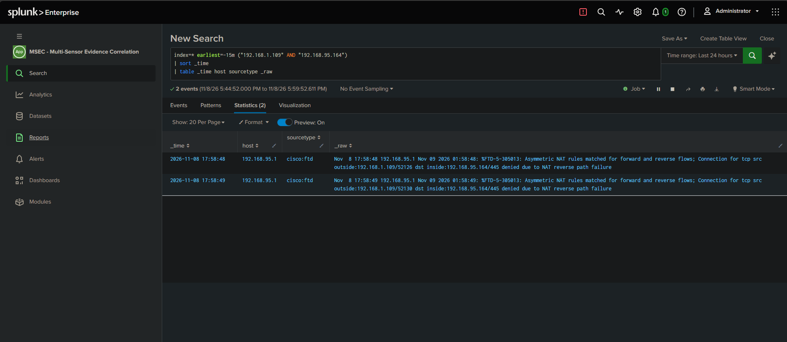
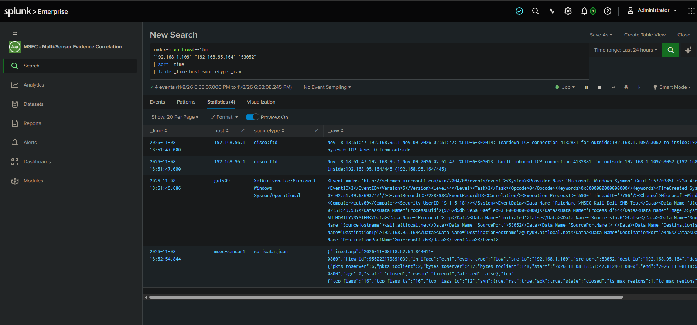

# Controlled Kali SMB Test — Three-Sensor Correlation

**Project:** MSEC — Multi-Sensor Evidence Correlation  
**Test Date:** November 8, 2026  
**Status:** Validated; cleanup completed  
**Environment:** Physical Enterprise Home SOC

## 1. Executive Summary

A controlled TCP connect scan from Kali Linux to a Windows 11 endpoint produced matching evidence across Cisco Firepower, Suricata, and Microsoft Sysmon in Splunk MSEC.

The verified connection was:

| Field | Value |
|---|---|
| Source IP | 192.168.1.109 |
| Source port | 53052 |
| Destination IP | 192.168.95.164 |
| Destination port | 445 |
| Protocol | TCP |
| Endpoint process | System |
| Process ID | 4 |

This exercise validates connection-level correlation across three sensors. It does not demonstrate exploitation, firewall bypass, credential access, or endpoint compromise.

Suricata recorded network flow evidence, not an IDS alert.

## 2. Relationship to the Internal Port-Scan Test

The earlier [Internal Network Service Discovery case study](internal-network-port-scan-t1046.md) validated a Suricata-based T1046 detection using a 1,000-port scan between hosts on the inside subnet.

This exercise used a different topology: Kali was on the Firepower outside network, and traffic to Dell traversed the firewall.

The single-port SMB test does not satisfy the earlier detection's threshold of 100 distinct destination ports.

## 3. Lab Environment

| Component | Role |
|---|---|
| Kali Linux — 192.168.1.109 | Authorized test source on the outside network |
| Firepower outside — 192.168.1.175 | Next hop for the temporary Kali host route |
| Dell Windows 11 — 192.168.95.164 | Inside endpoint running Sysmon |
| Cisco Firepower 1010 | Access control, NAT, and connection logging |
| Cisco Catalyst C1200 | Switching and SPAN traffic mirroring |
| Raspberry Pi — msec-sensor1 | Suricata sensor monitoring eth1 |
| Splunk Enterprise — 192.168.95.248 | Centralized collection and MSEC analysis |

Kali used a temporary route for the Dell destination:

```bash
sudo ip route add 192.168.95.164/32 via 192.168.1.175 dev wlan0
```

## 4. Controlled Configuration

### Firepower Access Control

The temporary rule `MSEC-T1046-Kali-Test` allowed:

- Source: Kali 192.168.1.109 on outside_zone.
- Destination: Dell 192.168.95.164 on inside_zone.
- Service: TCP destination port 445.
- Connection logging: Beginning and End.
- Syslog destination: Splunk 192.168.95.248.

### Identity NAT

After the initial NAT failure, a scoped identity NAT rule named `MSEC-Kali-Dell-NoNAT` was added before auto NAT rules.

It preserved both host addresses for outside-to-inside traffic between Kali and Dell.

### Windows Firewall

A temporary Windows firewall rule allowed only Kali to connect to Dell TCP 445:

```powershell
New-NetFirewallRule -Name "MSEC-Kali-SMB-Test" -DisplayName "MSEC Kali SMB Test" -Direction Inbound -Action Allow -Protocol TCP -LocalAddress 192.168.95.164 -LocalPort 445 -RemoteAddress 192.168.1.109 -Profile Any
```

These were deliberate, scoped permissions for a monitoring test. They did not provide credentials or a foothold.

## 5. Test Command

The same command was repeated after configuration changes:

```bash
nmap -sT -Pn -p 445 --reason 192.168.95.164
```

Successful runs reported:

```text
445/tcp open microsoft-ds syn-ack
```

## 6. Troubleshooting and Validation

| Stage | Observation | Finding |
|---|---|---|
| Initial scan with access Allow rule | Nmap filtered/no-response; Firepower denied traffic due to NAT reverse path failure | Access permission alone did not establish connectivity. |
| Identity NAT deployed | Firepower built records followed by SYN timeouts; Suricata saw SYNs without return packets | NAT denial resolved for these attempts, but Dell was not responding. |
| Scoped Windows rule added | Nmap reported open/syn-ack | The permitted service became reachable. |
| Initial Sysmon investigation | Network logging enabled, but no Event ID 3 evidence found | Endpoint collection required investigation. |
| Scoped Sysmon logging added | Matching local Event ID 3 appeared | Endpoint observation verified locally. |
| Forwarding investigated | Forwarder running and TCP 9997 reachable, but output paused warnings and receiver read timeouts present | Service state and reachability did not prove ingestion. |
| Forwarder restarted; test repeated | Matching Sysmon event appeared in Splunk | Three-sensor evidence verified for the fresh connection. |

The initial denied attempt occurred while the access Allow rule was already deployed. It was a NAT reverse-path failure, not a deliberately configured access-policy Block baseline.

The precise underlying cause of the stalled forwarding stream was not established.

## 7. Sysmon Visibility Change

The uploaded original configuration matched the SHA256 reported by Dell's loaded configuration.

NetworkConnect logging was enabled with selective include rules. Those rules did not explicitly include port 445 or System.

A separate test configuration preserved the existing rules and added:

```xml
<RuleGroup name="MSEC-Kali-Dell-SMB-Test" groupRelation="and">
  <NetworkConnect onmatch="include">
    <SourceIp name="MSEC-Kali-Dell-SMB-Test" condition="is">192.168.1.109</SourceIp>
    <DestinationIp condition="is">192.168.95.164</DestinationIp>
    <DestinationPort condition="is">445</DestinationPort>
    <Protocol condition="is">tcp</Protocol>
  </NetworkConnect>
</RuleGroup>
```

Sysmon validated and applied this configuration. The resulting event identified the added rule.

This changed logging coverage, not network access. The original configuration was restored after testing.

## 8. Verified Three-Sensor Evidence

All records matched TCP connection:

**192.168.1.109:53052 → 192.168.95.164:445**

Times below are November 8, 2026, America/Los_Angeles, UTC-08:00.

| Sensor | Time | Evidence |
|---|---|---|
| Firepower | 18:51:47 | Connection 4132881; built inbound TCP and teardown with TCP Reset-O from outside |
| Sysmon | Event timestamp 18:51:49.686 | Event ID 3; System; PID 4; NT AUTHORITY\SYSTEM; Initiated=false |
| Suricata | Flow start 18:51:47.812461 | Flow 956222179891039; matching addresses and ports; bidirectional packets; SYN/ACK/RST; closed; alerted=false |

Suricata recorded six packets toward the server and two toward the client.

Its flow record was emitted at 18:52:54.844011. That later timestamp is not the connection start.

The Sysmon event's embedded UtcTime was 2026-11-09 02:51:49.937, while its Windows event timestamp was 2026-11-09T02:51:49.6869374Z.

Clock alignment was not independently calibrated. Cross-sensor timestamp differences should not be interpreted as measured network latency.

Firepower's built and teardown messages share one-second timestamp precision; their table ordering does not establish causal ordering.

## 9. Splunk Correlation Search

This fixed-connection investigation search returned four rows: two Firepower, one Sysmon, and one Suricata.

```spl
index=* earliest=-15m
"192.168.1.109" "192.168.95.164" "53052"
| sort _time
| table _time host sourcetype _raw
```

Correlation was verified against the raw addresses, ports, protocol, process context, and timestamps.

This is an investigation search, not a reusable scheduled detection.

For historical replay, replace the relative range with the recorded test interval, subject to event retention.

[Download the four-event CSV](../evidence/exports/MSEC-Kali-SMB-Three-Sensor-53052.csv)
### Initial NAT Denial

Firepower denied the initial attempts due to NAT reverse path failure while the access rule was set to Allow.



### Verified Three-Sensor Correlation

Four events across Firepower, Sysmon, and Suricata match TCP connection 192.168.1.109:53052 → 192.168.95.164:445.


## 10. Cleanup

| Component | Completed action |
|---|---|
| Dell firewall | Removed MSEC-Kali-SMB-Test; follow-up lookup returned no rule |
| Firepower access | Changed MSEC-T1046-Kali-Test from Allow to Block |
| Firepower NAT | Disabled MSEC-Kali-Dell-NoNAT |
| Firepower deployment | Cleanup changes deployed successfully, per operator confirmation |
| Sysmon | Restored original sysmonconfig-export.xml; configuration validated and updated |
| Kali | Removed temporary host route through 192.168.1.175 |

Kali route verification showed the Dell destination using the original ISP gateway, 192.168.1.254, on wlan0.

No post-cleanup connectivity scan was performed. Cleanup was verified through rule lookup, configuration and deployment confirmation, and route inspection.

## 11. Findings

- Firewall permission, NAT behavior, and endpoint policy each affected reachability.
- A Suricata flow record is different from an IDS alert.
- A running forwarder and reachable receiver port do not establish successful ingestion.
- Sensor filters must cover the activity being investigated.
- Logging changes and cleanup are part of the experiment and must be documented.
- The same real connection was verified across firewall, network, and endpoint telemetry in Splunk.

**Final Result:** Three-sensor connection correlation validated, evidence exported, temporary access removed, and original endpoint logging restored.