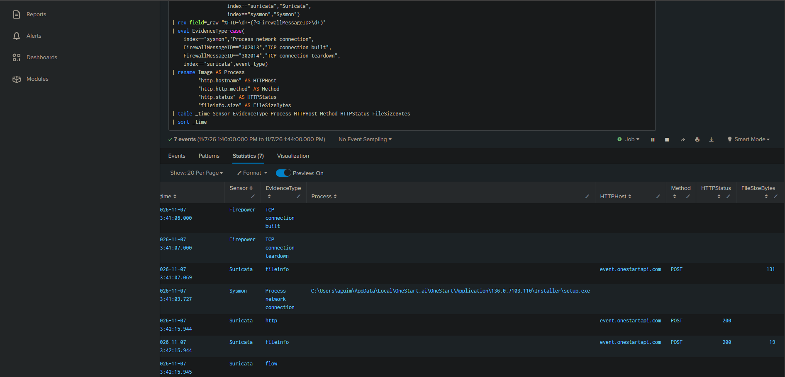

# OneStart Installer: Three-Sensor Investigation

## Objective

Correlate a network connection attributed to OneStart's installer with independent firewall and network sensor evidence.

## Scope

| Field | Value |
|---|---|
| Date | November 7, 2026 |
| Search window | 13:40-13:44 Pacific Standard Time |
| Endpoint | 192.168.95.155 |
| Source port | 60932 |
| Destination | 65.8.54.46:80 |
| Transport | TCP |
| Firepower connection ID | 3975115 |
| Suricata flow ID | 718898183055567 |
| HTTP hostname | event.onestartapi.com |

## Evidence Timeline



| Recorded time | Sensor | Observation |
|---|---|---|
| 13:41:06.000 | Firepower | TCP connection created |
| 13:41:07.000 | Firepower | Connection teardown; 736 bytes reported |
| 13:41:07.069 | Suricata | Request-side fileinfo; POST; size 131 bytes |
| 13:41:09.727 | Sysmon | Network connection attributed to OneStart Installer setup.exe |
| 13:42:15.944 | Suricata | HTTP POST transaction; response status 200 |
| 13:42:15.944 | Suricata | Response-side fileinfo; size 19 bytes |
| 13:42:15.945 | Suricata | Flow record |

Sysmon recorded this process image:

```text
C:\Users\aguim\AppData\Local\OneStart.ai\OneStart\Application\136.0.7103.110\Installer\setup.exe
```

ProcessGuid:

```text
{9762d5db-9ac5-6aef-b845-020000007c00}
```

## Correlation Method

- Match the endpoint IP, source port, destination IP, destination port, and TCP protocol.
- Account for both directions of the connection in Suricata.
- Use Firepower's connection ID to associate its creation and teardown records.
- Use Suricata's flow ID to associate its HTTP, fileinfo, and flow records.
- Attribute the endpoint connection using Sysmon Event ID 3 and its ProcessGuid.

The HTTP and response-side fileinfo records explicitly show stream flow-timeout emission. Their later timestamps do not establish a second connection.

## Findings

All three sensors recorded evidence associated with the same connection.

- Sysmon identified the OneStart installer process.
- Firepower corroborated the network connection and recorded its lifecycle.
- Suricata supplied application-layer context: a POST to event.onestartapi.com/ and an HTTP 200 response.

This demonstrates process attribution and network corroboration. It does not establish that all three sensors independently identified OneStart or detected a threat.

## Reproducible Evidence Search

This search uses fixed historical lab identifiers. It requires the original indexed events and the matching Splunk search timezone.

```spl
(index=firewall sourcetype="cisco:ftd"
 "192.168.95.155/60932" "65.8.54.46/80")
OR (index=suricata sourcetype="suricata:json"
 flow_id=718898183055567)
OR (index=sysmon SysmonEventID=3
 SourceIp="192.168.95.155" SourcePort=60932
 DestinationIp="65.8.54.46" DestinationPort=80)
earliest="11/07/2026:13:40:00" latest="11/07/2026:13:44:00"
| eval Sensor=case(index=="firewall","Firepower",
                   index=="suricata","Suricata",
                   index=="sysmon","Sysmon")
| rex field=_raw "%FTD-\d+-(?<FirewallMessageID>\d+)"
| eval EvidenceType=case(
    index=="sysmon","Process network connection",
    FirewallMessageID=="302013","TCP connection built",
    FirewallMessageID=="302014","TCP connection teardown",
    index=="suricata",event_type)
| rename Image AS Process
         "http.hostname" AS HTTPHost
         "http.http_method" AS Method
         "http.status" AS HTTPStatus
         "fileinfo.size" AS FileSizeBytes
| table _time Sensor EvidenceType Process HTTPHost Method HTTPStatus FileSizeBytes
| sort _time
```

## Remediation Context

During the broader OneStart investigation, related processes were stopped, the application was uninstalled, and scheduled tasks were removed.

A separate Sysmon-based recurrence rule was configured to monitor process creation from the OneStart.ai directory. That rule is distinct from this historical three-sensor evidence search.

## Limitations

- The supplied Suricata records are HTTP, fileinfo, and flow observations, not threat alerts.
- The request body was not available in the reviewed evidence. Its contents and purpose remain unknown.
- HTTP status 200 does not establish malicious activity, data theft, or a completed executable download.
- Fileinfo records report stored=false; they do not show that Suricata retained the transferred content.
- Firepower's byte count and Suricata's file sizes describe different measurements and should not be treated as equivalent.
- Recorded timestamps differ across sensors and event types; this is not a precise packet-level chronology.
- A source port and IP can be reused. This investigation uses a bounded time window and sensor-specific connection identifiers.
- This evidence does not establish how OneStart was originally installed.
