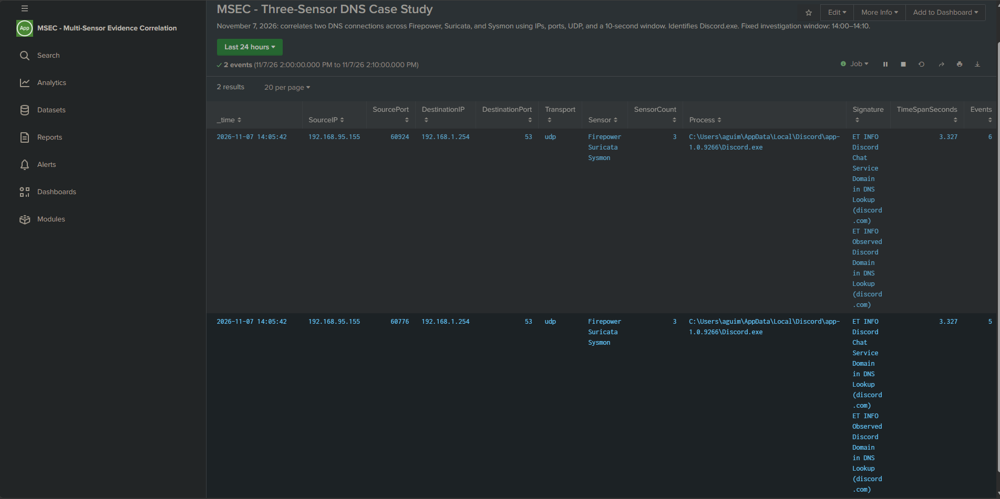

# Three-Sensor DNS Connection Correlation

## Objective

Identify the endpoint process associated with DNS activity observed by Suricata, and corroborate the connections using Cisco Firepower records.

## Environment and Scope

- Date: November 7, 2026
- Investigation window: 14:00-14:10, Pacific Standard Time
- Endpoint: 192.168.95.155
- DNS destination: 192.168.1.254:53
- Transport: UDP
- Source ports: 60776 and 60924

## Evidence



| Source port | Sensors | Associated process | Timestamp span | Records grouped |
|---|---|---|---|---|
| 60776 | Firepower, Suricata, Sysmon | Discord.exe | 3.327 seconds | 5 |
| 60924 | Firepower, Suricata, Sysmon | Discord.exe | 3.327 seconds | 6 |

The Sysmon process image was:

```text
C:\Users\aguim\AppData\Local\Discord\app-1.0.9266\Discord.exe
```

## Investigation Method

1. Review Suricata DNS alerts and their connection details.
2. Match Sysmon Event ID 3 using source IP, source port, destination IP, destination port, and protocol.
3. Identify the process recorded by Sysmon.
4. Retrieve Firepower connection creation and teardown records for the same connections.
5. Normalize the connection fields and group observations within ten seconds.
6. Retain groups containing all three sensors.

## Reproducible SPL

This historical search requires the original lab events. It contains fixed addresses, ports, and dates. Splunk's search timezone must match the investigation timezone.

```spl
(index=firewall sourcetype="cisco:ftd")
OR (index=suricata sourcetype="suricata:json" event_type=alert)
OR (index=sysmon SysmonEventID=3)
earliest="11/07/2026:14:00:00" latest="11/07/2026:14:10:00"
| rex field=_raw "for inside:(?<FTDSourceIP>[\d.]+)/(?<FTDSourcePort>\d+)"
| rex field=_raw "to outside:(?<FTDDestinationIP>[\d.]+)/(?<FTDDestinationPort>\d+)"
| rex field=_raw "(?i)(?<FTDTransport>UDP|TCP) connection"
| eval Sensor=case(index=="firewall","Firepower",index=="suricata","Suricata",index=="sysmon","Sysmon")
| eval SourceIP=coalesce(src_ip,SrcIP,SourceIp,FTDSourceIP),
       SourcePort=coalesce(src_port,SrcPort,SourcePort,FTDSourcePort),
       DestinationIP=coalesce(dest_ip,DstIP,DestinationIp,FTDDestinationIP),
       DestinationPort=coalesce(dest_port,DstPort,DestinationPort,FTDDestinationPort),
       Transport=lower(coalesce(proto,Protocol,protocol,FTDTransport))
| where SourceIP="192.168.95.155"
    AND DestinationIP="192.168.1.254" AND DestinationPort=53
    AND Transport="udp" AND SourcePort IN ("60776","60924")
| rename "alert.signature" AS Signature
| sort 0 - _time
| transaction SourceIP SourcePort DestinationIP DestinationPort Transport maxspan=10s
| eval SensorCount=mvcount(mvdedup(Sensor))
| where SensorCount=3
| rename Image AS Process duration AS TimeSpanSeconds eventcount AS Events
| table _time SourceIP SourcePort DestinationIP DestinationPort Transport Sensor SensorCount Process Signature TimeSpanSeconds Events
```

## Findings

Both connection groups contained Firepower, Suricata, and Sysmon evidence. Sysmon identified Discord.exe, while Suricata supplied Discord-related DNS signatures and Firepower supplied connection records.

The result demonstrates connection-level evidence correlation across three sensors.

## Limitations

- These informational DNS signatures do not establish malicious activity.
- The timestamp span is the difference between recorded event times, not a measurement of network latency or forwarding delay.
- Record counts include multiple signatures and connection lifecycle records; they are not counts of attacks or unique DNS queries.
- Tuple reuse, timestamp differences, and incomplete telemetry can affect matching.
- The Firepower fallback extraction assumes IPv4 addresses and interface names inside and outside.
- This search was validated at lab scale and has not been performance-tested for larger deployments.
